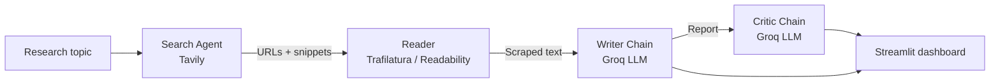

# 🔬 NEXUS AI: Multi-Agent Research Assistant

An AI research workspace where four agents work as a pipeline: one searches the web, one reads the pages, one writes a structured report, and one critiques it with a score out of 10.

[](https://multi-agent-research-system-24tb.onrender.com/)


**👉 Try it live: [multi-agent-research-system-24tb.onrender.com](https://multi-agent-research-system-24tb.onrender.com/)**

> The app runs on free tiers. The first load can take 30 to 60 seconds while the server wakes up, and the demo is limited to 3 research runs per session.

---

## 📸 Demo

## NEXUS AI home screen


## Research report and critic review


<!-- Optional: add a short screen recording as docs/demo.gif and uncomment the line below -->
<!--  -->

---

## ✨ What it does

Enter any research topic and NEXUS AI will:

1. **Search** the web for recent, reliable sources
2. **Read** the most relevant pages and extract clean text
3. **Write** a structured report (Introduction, Key Findings, Conclusion, Sources)
4. **Critique** the report with a score, strengths, and areas to improve

The dashboard shows the final report (downloadable as Markdown), the raw search results, the scraped content, and the critic's review.

---

## 🧠 How it works



All steps share one `state` dictionary, which is passed from step to step and returned to the UI.

| Step | Component | Role |
|------|-----------|------|
| 1 | Search Agent (LangChain agent + Tavily tool) | Finds sources for the topic |
| 2 | Reader (plain Python scraper) | Extracts readable text from the top pages |
| 3 | Writer Chain (prompt, LLM, parser) | Drafts the structured report |
| 4 | Critic Chain (prompt, LLM, parser) | Scores and reviews the report |

---

## 🛠️ Design decisions

Problems I ran into while building this, and how I handled them:

- **Failures don't kill the run.** If scraping fails, the writer falls back to the search results. If the critic fails, the report is still shown and the error is displayed in the Critic tab.
- **The reader doesn't use an LLM.** My first version let an agent choose and scrape URLs. It looped, repeated pages, invented URLs, and used up the daily token limit. Now plain Python extracts URLs from the search results, removes duplicates, and scrapes them directly, which costs zero tokens.
- **Reasoning models can return empty text.** The critic uses a dedicated model instance with low reasoning effort and a token cap, plus retries, so the answer isn't starved by hidden reasoning.
- **Two scraping strategies.** Trafilatura runs first, and Readability with BeautifulSoup is the fallback.
- **Usage caps on the demo.** A per-session limit and a global daily limit keep the free-tier API quota from running out, and rate-limit errors show a friendly message.

---

## 🧰 Tech stack

- **Orchestration:** LangChain, LangGraph
- **LLM:** Groq (`openai/gpt-oss-20b`)
- **Search:** Tavily
- **Scraping:** Trafilatura, Readability, BeautifulSoup, Requests
- **UI:** Streamlit
- **Deployment:** Render

---

## 📁 Project structure

```
.
├── app.py                    # Streamlit UI, usage limits, dashboard
├── requirements.txt
├── docs/                     # Screenshots for this README
└── src/
    ├── agents/
    │   └── agents.py         # LLMs, agents, writer and critic chains
    ├── tools/
    │   └── tools.py          # web_search and scrape_url tools
    └── pipelines/
        └── pipeline.py       # The 4-step research pipeline
```

---

## 🚀 Run it locally

**1. Clone the repo**

```bash
git clone <your-repo-url>
cd <your-repo-folder>
```

**2. Create a virtual environment** (Python 3.11 recommended)

```bash
python -m venv .venv

# Windows (PowerShell)
.venv\Scripts\Activate.ps1

# macOS / Linux
source .venv/bin/activate
```

**3. Install dependencies**

```bash
pip install -r requirements.txt
```

**4. Add your API keys.** Create a `.env` file in the project root:

```env
GROQ_API_KEY=your_groq_key
TAVILY_API_KEY=your_tavily_key
```

You can get free keys from [console.groq.com](https://console.groq.com) and [tavily.com](https://tavily.com).

**5. Start the app**

```bash
streamlit run app.py
```

Then open http://localhost:8501.

---

## ☁️ Deploy on Render

- **Build command:** `pip install -r requirements.txt`
- **Start command:** `streamlit run app.py --server.port $PORT --server.address 0.0.0.0`
- **Environment variables:** `GROQ_API_KEY`, `TAVILY_API_KEY`, `PYTHON_VERSION` (for example `3.11.9`)

---

## ⚠️ Limitations

- Free-tier API limits apply, so the demo may pause when the daily quota is used.
- Some websites block scrapers, so a few sources may return no content.
- Reports are only as good as the sources found. Always verify important claims.

---

## 🔮 Future improvements

- Let users add their own API keys in the sidebar
- Add a revision loop where the writer improves the report using the critic's feedback
- Export reports to PDF
- Cache results for repeated topics

---

## 👤 Author

**Shanmendra Sai Gajula**
2nd-year B.Tech student at KL University, building toward an AI/agentic AI engineering career.

- GitHub: [add your GitHub profile link]
- LinkedIn: [add your LinkedIn profile link]

Feedback and suggestions are welcome. Open an issue or reach out on LinkedIn.
